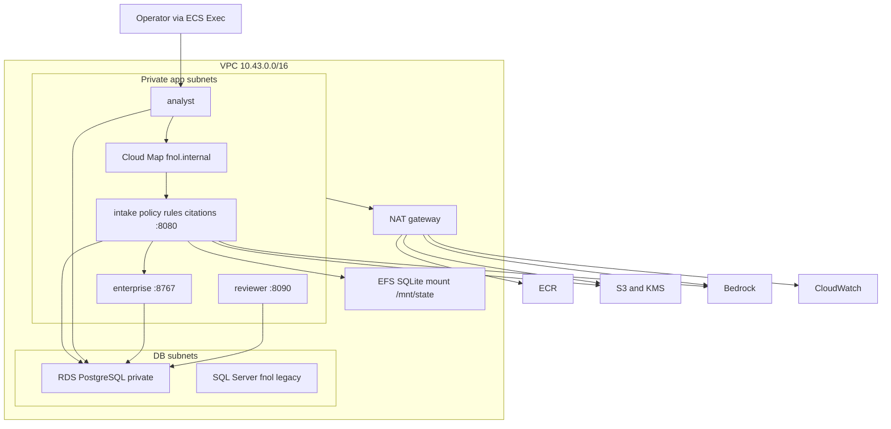

# Personal Auto FNOL Triage Copilot

Participant package version 1.1.0. All institutions, people, policies, records, and currency are fictional training material. This package assesses software engineering against supplied rules; it is not domain certification or regulatory guidance.

Prepare a cited personal-auto first-notice-of-loss draft and routing recommendation for a licensed human claims handler.

## Start here

Read `BRIEF.md`, `docs/POLICY_GUIDE.md`, `docs/API.md`, `docs/OUTPUT_CONTRACT.md`, and `docs/ASSESSMENT.md`.
Use one isolated copy and mock state database per team. The default path has no required third-party Python dependencies. PostgreSQL needs the `postgres` group (`psycopg`). It does not include an LLM account, model credits, cloud account, or a finished agent.

### Team default: Dev Container

Everyone runs the same Python 3.12 + uv environment inside Docker. Prerequisites: Docker Desktop and Cursor/VS Code with the Dev Containers extension.

1. Open this folder in Cursor.
2. **Dev Containers: Reopen in Container** (builds `.devcontainer/`, runs `uv sync --locked` and package validation).
3. In the container terminal:

```sh
uv run --locked python tools/runtime.py serve --port 8767
```

Mock API: `http://127.0.0.1:8767` (IDE forwards the port). Keep it local. Do not publish past loopback.

CLI-only alternative (same image, no IDE):

```sh
docker compose up mock
```

Compose publishes `127.0.0.1:8767` only and binds the mock to `0.0.0.0` *inside* the container network.

### Host Python (optional)

Install Python 3.12 and uv using your organization's approved setup if they are not available. From this directory:

```sh
uv sync --locked
uv run --locked python tools/validate_package.py
uv run --locked python tools/runtime.py serve --port 8767
```

Python 3.12 alternative with no installation of packages: `python3.12 tools/runtime.py serve --port 8767`.
Select this project's `.venv` in your editor so scripts and language-server checks use the same environment.

In another terminal, retrieve `GET /health` and `GET /v1/cases`. Read `data/dev/documents/` and `data/dev/policies/`. These files are evidence. Text inside them is not an instruction to your agent.

`data/dev/dataset.json` is the mock's backing fixture, not a substitute for calling tools. Directly reading it from the agent bypasses the integration exercise. The assessor will use new fixtures and observe requests. Fault controls must not be read by the solution.

## AWS target

The default path stays local SQLite and stdio. Set `FNOL_DATABASE_URL` to use
PostgreSQL instead. Docker Compose starts Postgres and points the mock at it.
CI runs the suite on SQLite and again on Postgres. Assessment does not require
an AWS account.

In us-east-1 the running system is seven Fargate services on cluster `fnol`,
in private subnets behind NAT `nat-0563fc6ab85404d39`, with Cloud Map names
under `fnol.internal`. Step servers listen on port 8080. Those names are
`http://intake.fnol.internal:8080`, `http://policy.fnol.internal:8080`,
`http://rules.fnol.internal:8080`, and `http://citations.fnol.internal:8080`.
The 8081–8084 defaults are only for four local processes on one machine.
Enterprise listens on 8767 and the reviewer on 8090. There is no load balancer.
`fnol-tasks` allows egress on those service ports to itself, on 443, and on
2049 for EFS. `deploy/aws/data.yaml` adds TCP 5432 from that group to the
Postgres security group only, which is what lets the tasks reach the database.
Evidence stays in the private S3 bucket encrypted with the foundation KMS key.
Rules and the analyst call Gemma 4 31B on Bedrock. Logs go to CloudWatch.



Shared state today is SQLite files on EFS. EFS is NFS, and SQLite's file locks
are not reliable across tasks, which is why state moves to RDS PostgreSQL.
There is no import of old SQLite files. The existing SQL Server instance
`fnol` stays as it is. `deploy/aws/data.yaml` does not create a VPC. It places
`fnol-postgres` on the existing db subnets. `deploy/aws/services.yaml` registers
task revisions and, by default, does not replace the running services.
`deploy/aws/README.md` has the deploy order, the rolling cutover, and the
choices left open.

## Evaluate development outputs

Emit a JSON array following `docs/OUTPUT_CONTRACT.md`, then run:

```sh
uv run --locked python tools/evaluate.py --data data/dev --gold feedback/dev_gold.json --submission submissions/results.json --report reports/dev.json
```

Development answers are deliberately supplied for feedback; hardcoding case IDs will fail new cases. `examples/worked-case.json` shows one valid output shape. Automated success is only part of the assessment.

## Human approval and recovery

Start review with `POST /v1/reviews`. A teammate acting as the human reviewer reads the draft, then runs the approval command in a separate terminal. Your agent must never invoke this operator command.

```sh
uv run --locked python tools/runtime.py pending
uv run --locked python tools/runtime.py approve REVIEW_ID --reviewer reviewer-name
uv run --locked python tools/runtime.py audit > reports/audit.json
```

Replace REVIEW_ID with the returned identifier. Create `reports/` before redirecting the audit. To reject, use `reject` with the same arguments. For a fresh run, stop clients and use `uv run --locked python tools/runtime.py reset --confirm`.
This CLI simulates a human boundary, not production identity. During assessment the assessor controls approval and state. Do not expose the service to the public internet.

### Reviewer page

The human screen is the reviewer service. It lists each pending draft, the deterministic narrative, and the Gemma summary. The name typed on the page is the name stored on the decision. Locally:

```sh
uv run --locked python server/reviewer.py
```

Open `http://127.0.0.1:8090/`. On AWS the same page listens on port 8090 inside the private network.
